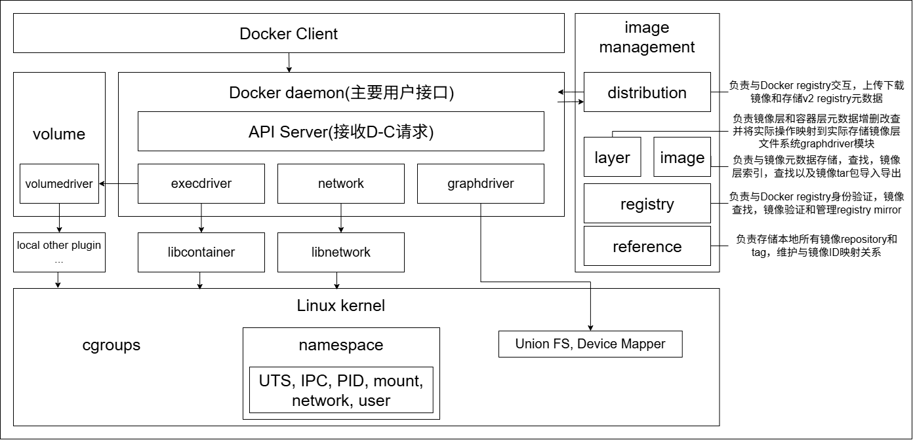

# Docker

## Use

| 分类         | 命令                                                                                         |
| ---------- | ------------------------------------------------------------------------------------------ |
| Docker环境信息 | `info`、`version`                                                                           |
| 容器生命周期管理   | `create`、`exec`、`kill`、`pause`、`restart`、`rm`、`run`、`start`、`stop`、`unpause`               |
| 镜像仓库命令     | `login`、`logout`、`pull`、`push`、`search`                                                    |
| 镜像管理       | `build`、`images`、`import`、`load`、`rmi`、`save`、`tag`、`commit`                               |
| 容器运维操作     | `attach`、`export`、`inspect`、`port`、`ps`、`rename`、`stats`、`top`、`wait`、`cp`、`diff`、`update` |
| 容器资源管理     | `volume`、`network`                                                                         |
| 系统日志信息     | `events`、`history`、`logs`                                                                  |

## Theory
Docker容器本质是宿主机进程，通过namespace实现资源隔离，cgroups实现资源限制，写时复制机制实现高效文件操作
Namespace资源隔离:
- UTS namespace: 提供主机名和域名隔离
- IPC namespace: 进程间通信隔离，包括信号量，消息队列和共享内存
- PID namespace: 对进程PID重新标号
- mount namespace: 通过隔离文件系统挂载点对隔离文件系统提供支持
- network namespace: 网络隔离，包括网络设备，IPv4和IPv6协议栈，IP路由表，防火墙等
- user namespace: 隔离安全相关标识符和属性，包括用户ID，用户组ID，root目录，密钥和特殊权限

## Architecture

!!! tip "如何添加"
    在 `docs/devops/container/` 下新建 `.md` 文件，并在 `mkdocs.yml` 登记